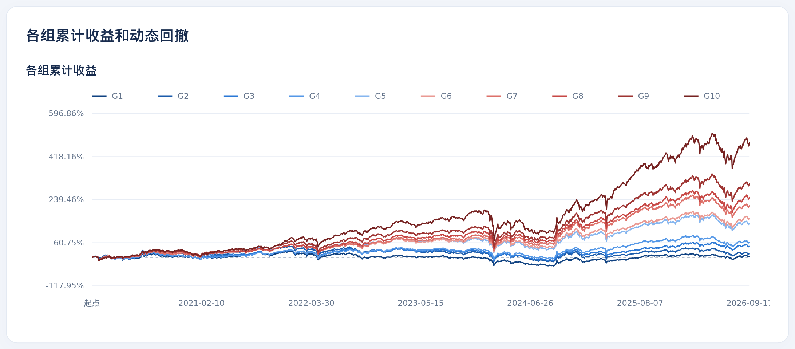
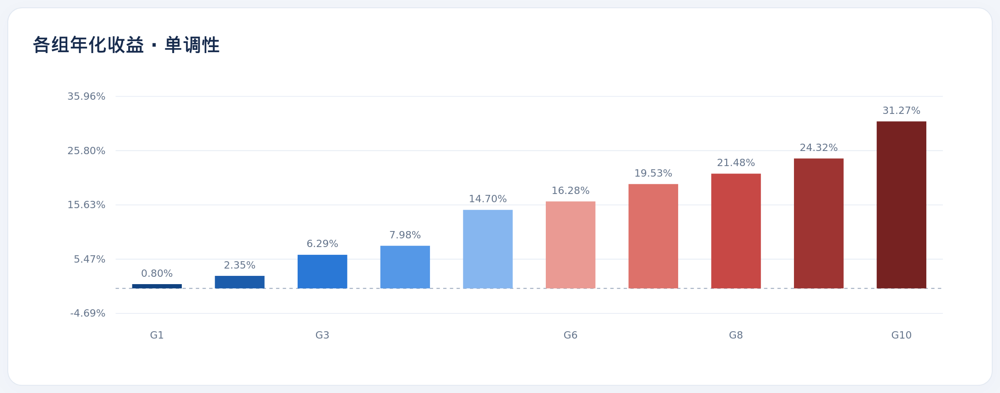
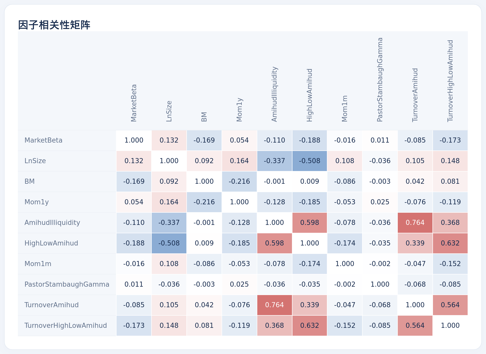

# A 股因子研究

基于分钟和日线行情的 A 股选股因子研究框架。完整流程是：整理行情 → 构建高频和中频因子 → 分组回测、计算 IC → 输出交互式 HTML 报告和每日多头持仓清单。

```text
原始 CSV ──数据更新──▶ 分钟 / 日线 / 财务 parquet ──因子构建──▶ 每个因子一个 parquet ──因子评估──▶ 指标 CSV + HTML 报告 + 持仓清单
```

## 快速开始

1. 复制 `config_local.example.json`，命名为 `config_local.json`，把 `root_dir` 设为代码目录和 `a_share_market_data/` 共同的上级目录。配置里以 `_dir` / `_path` 结尾的字段都相对这个目录解析。
2. 在 [main.py](main.py) 中修改 `CONFIG_FILE` 选择任务，然后运行 `python main.py`。

| 任务 | `CONFIG_FILE` | 入口类 |
| --- | --- | --- |
| 数据更新 | `portfolio_20260905/config/config_data_update.json` | `DataUpdater`（经 `update_data/update_data.py` 的 `run(config)` 调用） |
| 因子构建 | `portfolio_20260905/config/config_factor_construction.json` | `HighFreqFactorConstructor` / `MiddleFreqFactorConstructor`（经 `factors/construction/factors.py` 的 `run(config, construction_mode)` 调用） |
| 因子评估 | `portfolio_20260905/config/config_factor_evaluation.json` | `SingleFactorEvaluation` / `MultiFactorEvaluation`（经 `factors/evaluation/evaluation.py` 的 `run(config, evaluation_mode)` 调用） |
| 交易策略 | `portfolio_20260905/config/config_trading_strategies.json` | `StrategyEvaluation`（经 `trading_strategies/evaluation.py` 的 `run(config)` 调用） |

第一次使用时按表格顺序执行。仓库不含行情数据，需要自行准备。前三个任务都有 `update_all` 字段：设为 `1` 时全量重算并覆盖结果，设为 `0` 时只补算缺失的日期。

依赖：pandas、numpy、pyarrow、tqdm。

## 目录结构

```text
main.py                  # 入口与配置加载
config/                  # 各类任务的配置
update_data/             # 数据更新：update_data.py 为唯一入口，行情整理、复权、生成回测数据
construct_asset_pool/    # 下载股票基础信息与交易日历（单独运行）
factors/construction/    # 因子构建：factors.py 为唯一入口，构建器与因子实现分高频 / 中频
factors/evaluation/      # 因子评估：evaluation.py 为唯一入口，含单因子与批量评估、相关性分析、HTML 报告
trading_strategies/      # 交易策略：evaluation.py 为唯一入口，strategies/ 放策略，strategies_evaluation/ 放回测与报告
factor_list.csv          # 高频因子清单及算子公式
```

## 数据更新

从 `new_data_dir` 读取 `daily_minutes.csv`、`stock_exrights.csv`、`limit_price.csv`、`stock_st_status.csv`、`mkcap.csv` 和 `fundamentals_quarterly.csv`，结果写到 `output_dir`：

| 输出 | 内容 |
| --- | --- |
| `stock_minutes/<年>/<日期>.parquet` | 按交易日拆分的分钟行情 |
| `stock_daily/daily_stock_data.parquet` | 后复权日线 OHLC，附当日总市值 `mkcap`（元）、交易日序号 `trade_day`（相邻交易日相差 1，个股序号不连续即有停牌）和停牌标记 `is_suspended`（全天成交量为 0；当天缺失数据在因子构建中同样视为停牌） |
| `stock_daily/daily_stock_data_10am.parquet` | 每日 10:00 后复权价格，作为回测成交价；附与日线相同的 `trade_day`，停牌标记 `is_suspended`（停牌日保留价格，不计入连续交易天数，记为空），以及连续交易天数 `consecutive_trading_days`（停牌 10 个交易日及以上时重新计数） |
| `fundamentals/financial_data.parquet` | 季度财报，每个报告期一行，以 `code`、`report_date`（报告期末）为唯一键，公告日为 `date`（匹配日线时使用）；流量变量转为 TTM（`*_ttm`）和当季度值（`*_q`） |
| `fundamentals/`、`limit_price/`、`stock_st_status/` | 日度和月度市值、涨跌停价、ST 状态 |

## 因子构建

`construction_mode` 取 `high`（高频）或 `middle`（中频）。`factor_list` 和 `middle_factor_list` 分别列出要计算的高频、中频因子，留空表示计算对应目录下的全部因子。

| 类型 | 输入 | 因子举例 |
| --- | --- | --- |
| 高频 | 当日分钟行情 | 分时段动量、开盘和尾盘成交占比、分钟收益偏度和峰度、量价相关性、上行和下行波动率等，完整清单见 [factor_list.csv](factor_list.csv) |
| 中频 | 历史日线和财务数据 | `LnSize`、`BM`、`MarketBeta`、`Mom1m`、`Mom1y`、`AmihudIlliquidity` 及其变体、`PastorStambaughGamma` |

- 股票池剔除 ST 股，以及连续交易不满 250 天的股票。
- 每个脚本对应一个因子，输出的 parquet 只有 `code`、`date` 和以因子名命名的一列因子值。多日均值等变体单独写成因子，如 `AmihudIlliquidity1m` 是最近 20 个交易日 `AmihudIlliquidity` 的均值。
- 新增因子的方法：在 [high_freq_factor_calculation/](factors/construction/high_freq_factor_calculation/) 或 [middle_freq_factor_calculation/](factors/construction/middle_freq_factor_calculation/) 下新建与类名同名的文件，继承 `_BaseHighFreqFactor` 或 `_BaseMiddleFreqFactor`，实现 `calculate()`，返回 `code`、`date` 和以类名命名的一列因子值。构建器按文件名自动注册。中频因子还需设置 `lookback_days`：增量更新时构建器按其最大值多预留 1 个交易日截取历史日线，因此因子最早用到的日线距当日不能超过 `lookback_days` + 1 个交易日。

## 因子评估

`evaluation_mode` 设为 `single` 时，只评估 `specified_column` 指定的因子（即因子文件名）；设为 `multi` 时，评估因子目录下的全部因子。每个因子文件只读取与文件名同名的一列。两种模式最后都用因子目录中已有评估结果的全部因子生成同一份 HTML 报告。评估口径如下：

- **股票池**：按 `stock_board`（`main board` 或 `all`）筛选板块，再按上月末市值每日保留最小的 `stock_pool` 只股票。
- **收益**：因子值滞后一天使用，当日 10:00 买入，持有到下一交易日 10:00。
- **持有期**：`holding_periods` 设定持有的交易日数（默认 1、5、10、20 天）。持有 N 天时每个交易日买入一批、同时持有最近 N 批，各批等权，组合日收益取各批当日收益的均值；IC 和 RankIC 用之后 N 天的复利累计收益计算，换手率为当日买入批与卖出批（N 天前买入）的成分变动比例，不折算为日均。持有 1 天的结果始终计算，持仓清单和批量指标汇总都基于它。
- **分组**：每日按因子值等分为 `group_number` 组，计算各组收益、IC、RankIC 和换手率。IC 均值为正时做多因子值最高的组，否则做多最低的组。不计交易成本。
- **多因子分析**：报告中全部因子并列比较；相关性矩阵为因子两两之间每日截面 Pearson 相关系数的时间均值，使用当日因子值，按相同的板块和小市值规则取股票池，逐日截面标准化后计算。

输出默认位于 `a_share_market_data/factors_evaluation_output/`：

| 路径 | 内容 |
| --- | --- |
| `numerical_output/<因子>.csv` | 每日分组收益、IC、RankIC、股票数、换手率；持有 1 天以外的列加 `_<N>d` 后缀，如 `group_1_5d`、`IC_5d` |
| `numerical_output/factor_comparison.csv` | 批量模式的指标汇总，每个因子一行 |
| `visualization_output/factor_evaluation_report.html` | 因子评估报告，单个可离线打开的 HTML 文件：上半部分并列对比全部因子（指标对比表、分组年化收益、累计收益与累积 IC 曲线、分年对比、相关性矩阵），下半部分用按钮切换因子，查看因子详情和分年表现；持有期和分析时间区间在页面中切换 |
| `stock_list/<因子>.csv` | 历史每日多头持仓 |
| `stock_list/next_day/<因子>.csv` | 由最新收盘信号得到的下一交易日目标持仓 |

持仓清单会附上 `__daily_data_update/stock_info.csv` 中的股票名称、行业等信息。

## 交易策略

`config/config_trading_strategies.json` 中公共字段放在顶层，各策略的专有参数放在 `strategies` 下以策略类名为键的子 dict 里，`strategy` 指定运行哪个策略。代码分三层：

1. **策略**（[trading_strategies/strategies/](trading_strategies/strategies/)）：文件名即类名，输出每日持仓清单，列为 `strategy`、`date`（信号日）、`trade_date`（实际交易日）、`code`、`name`、因子值列和 `hold`（False 表示当日空仓）。清单包含最后一个尚无收益的下一交易日。目前有 `MarketTiming`：主板中按 Amihud 非流动性取股票池、按波动率选股，用池子净值均线和微盘股同涨同跌程度择时。
2. **回测**（`strategies_evaluation/strategy_backtest.py`）：以 `initial_cash` 为初始现金，信号日的下一交易日 10 点按未复权价等权调仓，持有到再下一交易日 10 点。调仓时把现金与可卖持仓的变现金额等分给目标股票，每只向下取整到 100 股，剩余部分持有现金，现金不会透支；持仓数量每日按复权因子的变化调整；10 点价格涨停不买入、跌停不卖出，停牌不能买卖。三种口径是同一组成交下的盈亏（元）：理论按 10 点价格成交且不收费，扣费再减去费用（每只股票每天的买入或卖出算一笔，费用 = 成交金额 × `fee_rate`，不足 `min_fee` 时按 `min_fee` 收），扣费+滑点再减去买入按 10 点最高价、卖出按最低价成交的差额，即账户的真实盈亏。
3. **报告**（`strategies_evaluation/strategy_report.py`）：读回测输出生成 HTML，分总览（指标卡片、累计盈亏（元）和回撤曲线，可用滑块选择时间窗口，指标卡片和两条曲线都按窗口重新计算、盈亏从 0 开始累计，点击某一天查看当日逐股明细）、分年（分年指标、月度收益矩阵）和下一交易日持仓（含买入 / 保持 / 卖出动作）三个标签页。

`holdings_path` 为空时运行 `strategy` 指定的策略；填入一份持仓清单 CSV 的路径时跳过策略，直接回测该清单。输出位于 `a_share_market_data/strategies_evaluation_output/<策略名>/`：

| 文件 | 内容 |
| --- | --- |
| `<策略名>Holdings.csv` | 每日持仓清单 |
| `<策略名>Curve.csv` | 每日调仓后的现金、持仓市值、仓位、换手，三种口径的日盈亏（元）、账户资产（元）、日收益率和动态回撤 |
| `<策略名>Metrics.csv` | 全区间和每个年份、三种口径的绩效指标（收益、波动、Sharpe、Sortino、最大回撤及起止日、Calmar、胜率、换手等），存原始数值 |
| `<策略名>Details.csv` | 每日逐股明细：调仓前 / 调仓后股数、未复权买入价和卖出价、个股收益、盈亏、费用、滑点（金额单位为元）、涨跌停和停牌标记 |
| `<策略名>Evaluation.html` | 交互式回测报告 |

## 结果示例

### AmihudIlliquidity 单因子表现

Amihud 非流动性 = 日收益率绝对值 / 当日成交额。评估区间为 2020-01-02 至 2026-09-17，样本为主板市值最小的 2000 只股票，每日分 10 组：

| IC 均值 | RankIC 均值 | ICIR | 多头（G10）年化收益 | 多空年化收益 | 多头日均换手率 |
| --- | --- | --- | --- | --- | --- |
| 0.011 | 0.030 | 0.14 | 31.3% | 29.4% | 61.8% |





从 G1 到 G10，年化收益单调上升，非流动性越高的组收益越高。以上收益未计手续费和滑点；多头组日均换手率约 62%，扣除成本后的实际收益会明显更低。

### 因子相关性矩阵

下图取自因子评估报告的相关性矩阵，数值为每日截面 Pearson 相关系数的时间均值。



Amihud 类因子之间高度相关（如 `AmihudIlliquidity` 与 `TurnoverAmihud` 为 0.76）。其中 `AmihudIlliquidity` 和 `HighLowAmihud` 与市值明显负相关，分别为 −0.34 和 −0.51。
